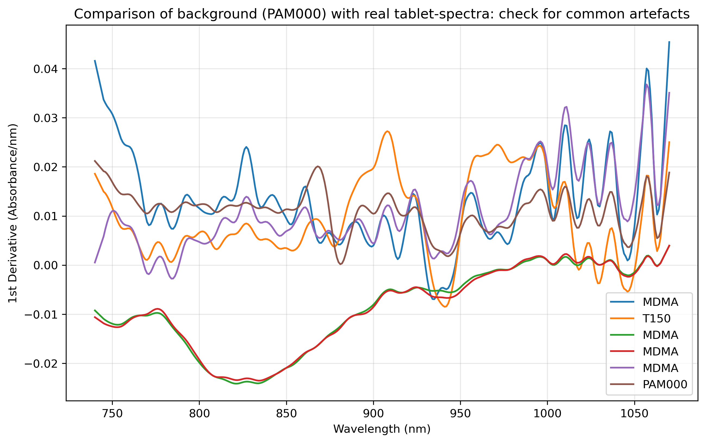
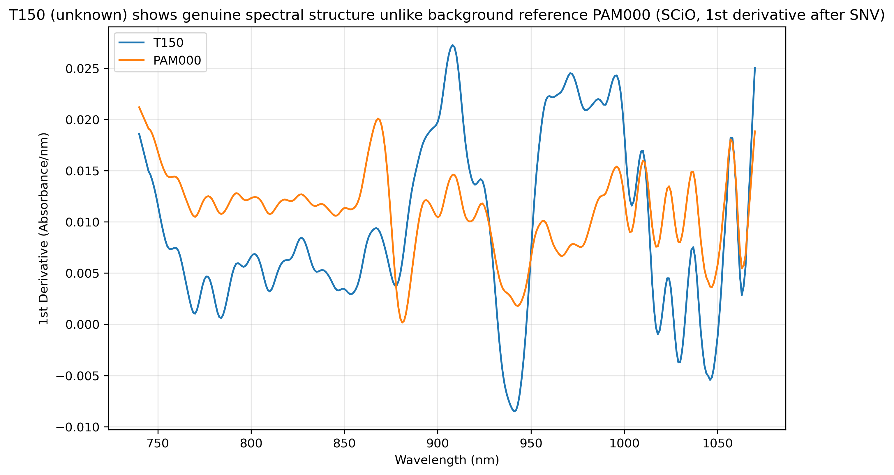
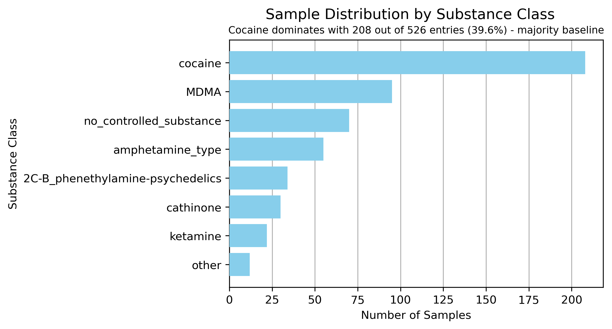

## 1. Motivation
The objective of this project is to ascertain whether the class of a substance 
can be identified with precision.
Therefore, the utilisation of NIR spectral data from a range of both legal and 
illegal substances is employed, with the measurement being conducted using five 
distinct instruments. The data has been published by Kranenburg et al., and this 
research is of significance firstly for On-Site Drug-Checking.
This non-destructive, low-level method, for which no specialists are required, 
has the capacity to clarify whether the sample has been identified with certainty, 
or whether further chemical (or physical) analysis is required in a laboratory to 
facilitate identification. The spectra presented herein have been obtained through 
the utilisation of four distinct portable near-infrared (NIR) spectrometers and a 
laboratory-based one used as a benchmark, each operating within a distinct 
wavelength range. The products under discussion are distinguished by their ease
 of use and affordability. The challenge is threefold: first, to utilise a 
database with comparison spectra in order to ensure the quality of the data; secondly, 
to develop algorithms for preprocessing; thirdly, to engineer an appropriate 
machine-learning model and evaluate it across the various instruments.
## 2. Data
Research Article: Kranenburg, Ruben F. et al. 
"The importance of wavelength selection in on-scene identification of drugs of 
abuse with portable near-infrared spectroscopy" DOI: 10.1016/j.forc.2022.100437

Data Article: Kranenburg, Ruben F. et al. "Dataset of near-infrared spectral 
data of illicit-drugs and forensic casework samples analyzed by five portable 
spectrometers operating in different wavelength ranges" DOI: 10.1016/j.dib.2022.108660

Data: DOI: 10.21942/uva.21252300 (Lizenz CC-BY)

The data is not included in the repository due to restrictions on the licence; 
however, it can be downloaded using the Digital Object Identifier (DOI) provided above.

**Instruments (NIR-spectrometers)**

|Instrument|Wave-length range (nm)| Raw data output (data points)| Resolution (FWHM)|
| :---- | :-----| :----- | :----- |
ASD LabSpec 4 | 350-2500 |2151 | 10|
NeoSpectra | 1300-2600|160|16|
NIRone 2.0 | 1550-1950|201|15-21|
MicroNIR|950-1650|125|12.5|
SCiO|740-1070|331|n.a.|

**Sample-Sets**

|Symbol|Explanation|Count|
| :---- | :----- | :----- |
|C| Common drugs|17|
|D|Designer drugs|38|
|N|Cocaine-negative samples, adulterants (powdered, white)|40|
|PAM|Police Amsterdam powdered casework samples|200|
|K|Calibration set of binary cocaine mixtures|88|
|T|Tablets|72|
|P|Crushed, powdered tablets|71|

A **total of 526 samples** have been analysed, divided between five instruments or 
24 spectral data sets.

## 3. Data quality findings

### 3.1 SCiO reflectance transform 
The SCiO-raw data are measured in reflectance; consequently, they are transformed 
to the corresponding absorption values using the negative natural-logathim. 
ln-transformation: used methods are invariant against linear scaling.
Kranenburg et al. employed a similar methodology, but didn't state whether they use
-log10 or -ln. The following details are 
provided in order to serve as background information for the SCiO. The PAM000 
data is identified below. It is not stated in the data paper whether the 
background has been subtracted. As a consequence of the implementation of a 
SNV transformation for the purpose of normalising the data, the background is not removed.  

### 3.2 Background reference PAM000
Given the observation that PAM000 is present exclusively within the SCiO dataset, 
it was hypothesised that this may be indicative of a background measurement. 
PAM000 (background reference scan) was evaluated against type-level spectral 
centroids across all sample sets (tablets, crushed tablets, adulterants, cocaine mixtures).
Across the entire dataset, PAM000 demonstrated no discernible discriminatory 
affinity for any particular substance class. The highest correlation coefficients 
were moderate in nature and exhibited a broad distribution (MDMA: 0.43 in T-set; 
no_controlled_substance: The NCD-set yielded a result of 0.32, while the K-set 
produced a result of 0.09 for cocaine. The raw-domain comparison confirms that 
PAM000 is devoid of substance-specific absorbance patterns, exhibiting only a near-linear baseline. 
It is concluded that PAM000 is a white-reference measurement devoid of any controlled substance content.

*Figure 1: Comparison of PAM000 with 4 tablets. It exhibits weak structure 
(particularly <950 nm), indicating a near-constant background.
(1st derivative, SNV-normalized)*

### 3.3 Unidentified sample T150 

T_scio set consists of 72 samples, but it has only 71 entries in the metadata-file. 
The comparison with the T-spectral-data of the other instruments shows that the sample
labeled T150 is only present in the SCiO-data.
The spectral comparison with the T_ASD-data falsifies the hypothesis, that "T150" is a typo. The Top-candidate
would be T32 (MDMA) with = 0.74. 
The varaince of the first derivative shows that T150 is a tablet spectrum (Rank 4 of 72) over the
PAM000 background (Figure 2)

Supplementary observation: T150 was compared against type-level centroids 
of all SCiO sample sets. Highest similarity was observed for 
2C-B_phenethylamine-psychedelics (r=0.85), while the top pairwise ASD 
candidate (T32) is an MDMA tablet. The two independent analyses point to 
different substance classes, reinforcing that no reliable assignment exists. 
Exclusion stands.

*Figure 2: T150 displays spectral dynamics comparable to genuine tablets, unlike the flat background curve PAM000. 
(1st derivative, SNV-normalized)*

### 3.4 Data Quality Inspection: negative absobance values

During data quality inspection of the replicate-averaged MicroNIR spectra, 
negative absorbance values were found in 27 averaged samples across
 the K, N, D, PAM and C sample families (Table 3). Negative absorbance is
  physically implausible, as it would imply the sample reflects more light
   than the white reference. The affected values are all small in magnitude 
   (mostly < 0.005, maximum ≈ [0.0226] at 939 nm) and occur predominantly in the lower 
   wavelength region of the MicroNIR detector (~939–1140 nm; individual values 
   up to ~1330 nm with magnitudes below 4·10⁻⁴), where the signal-to-noise 
   ratio is poorest. We therefore interpret them as instrument noise near 
   the detection limit rather than as real spectral information. The values 
   were retained unmodified in the interest of minimal data manipulation; 
   given their magnitude and localization, their impact on downstream 
   preprocessing (SNV, Savitzky–Golay) and modelling is negligible. 
   Note: replicate averaging already removed all negative values observed 
   in the raw P_MicroNIR scans.
  
   
  ||      codes| val_range|wl_range|
  |:---|:--------------|:-----------------|:---------------|
  | 0 |     K14|   [-0.0034288, -2.46e-05]|   [976.238, 1087.736]|
 |  1 |     K22|   [-0.0006039, -0.000213]|  [1062.959, 1087.736]|
 |  2 |     N12|      [-0.0010211, -3e-07]|   [976.238, 1137.291]|
 |  3 |     N14|  [-0.0226031, -0.0002313]|    [939.072, 1335.51]|
 |  4 |     N24|  [-0.0034334, -0.0002624]|  [1062.959, 1124.902]|
 |  5 |     N26|  [-0.0040723, -0.0002805]|  [1081.542, 1143.485]|
 |  6 |     N38|   [-0.009108, -0.0004545]|   [1007.21, 1137.291]|
 |  7 |      D1|   [-0.0050195, -3.79e-05]|   [963.849, 1112.514]|
 |  8 |     D10|  [-0.0151703, -0.0003608]|    [951.46, 1316.927]|
 |  9 |     D11|   [-0.0107948, -7.83e-05]|    [951.46, 1242.595]|
 |  10|     D19|  [-0.0025949, -0.0006923]|  [1038.181, 1100.125]|
 |  11|     D28|   [-0.0036914, -3.15e-05]|   [994.821, 1106.319]|
 |  12|     D37|  [-0.0102765, -0.0001639]|    [957.655, 1292.15]|
 |  13|      C4|  [-0.0103429, -0.0005075]|   [957.655, 1285.956]|
 |  14|      C7|  [-0.0067368, -0.0001886]|   [970.044, 1106.319]|
 |  15|    PAM1|   [-0.0038432, -0.000124]|   [976.238, 1106.319]|
 |  16|   PAM12|  [-0.0117236, -0.0003386]|    [957.655, 1292.15]|
 |  17|   PAM35|  [-0.0058371, -0.0002101]|   [982.432, 1100.125]|
 |  18|   PAM42|  [-0.0076247, -0.0001556]|   [976.238, 1100.125]|
 |  19|   PAM44|   [-0.0002471, -5.41e-05]|  [1069.153, 1081.542]|
 |  20|   PAM57|   [-0.0082419, -4.02e-05]|   [963.849, 1100.125]|
 |  21|   PAM59|    [-0.0054652, -6.9e-06]|   [982.432, 1143.485]|
 |  22|   PAM62|  [-0.0028447, -0.0007377]|  [1044.376, 1093.931]|
 |  23|   PAM67|  [-0.0086436, -0.0005071]|   [963.849, 1112.514]|
 |  24|   PAM83|   [-0.0066404, -0.000314]|   [976.238, 1100.125]|
 |  25|   PAM94|   [-0.0031154, -7.87e-05]|   [976.238, 1100.125]|
 |  26|   PAM95|  [-0.0031682, -0.0001695]|   [976.238, 1093.931]|
 |  27|  PAM107|   [-0.014651, -0.0001453]|    [951.46, 1310.733]|
 
 **Table 3** Negative Absorbance: (Occurs only within MicroNIR): 
 Samlpe-Code, Minimal and Maximal wavelength with negative values and
 respective absorbance values 
 
### 3.5 NeoSpectra: Wavelength grid consistency

During data quality inspection, the NeoSpectra modelling dataset contained 312 
spectral columns instead of the expected 160, with 65,208 missing spectral values. 
Investigation revealed that the raw files use nominally identical wavelength grids 
whose floating-point representations differ slightly. The maximum observed deviation 
between the compared grids was approximately ($4.1 \times 10^{-12}$) nm.

When spectra from different sample sets were combined, these tiny numerical 
differences caused nominally identical wavelengths to be treated as separate columns. 
Consequently, the resulting dataset contained duplicate wavelength positions and missing values.

**Correction:** Wavelength column labels are rounded to eight decimal places when 
the raw data are loaded. The averaged spectral cache was rebuilt after incrementing 
the preprocessing version.

**Validation:** After rebuilding the cache, the NeoSpectra modelling dataset 
contained 429 samples, exactly 160 spectral columns, and no missing spectral values.

This correction standardizes floating-point representations of the wavelength labels; 
it does not resample or otherwise alter the spectral measurements.
   
## 4. Modeling Baseline Designer

### 4.1 Target variable: type

The original dataset defines individual substance names (cocaine, MDMA, heroin 
brown, 2C-B, etc.), resulting in highly fragmented class labels with very few 
samples per class (many with n ≤ 5). To enable statistically meaningful 
classification evaluation, a **hierarchical grouping** has been introduced in metadata.xlsx:

|type|Sample Count|Rationale|
| :---- | :----- | :----- |
|cocaine |	208|	Controlled substance (primary target)|
|MDMA|	95	|Controlled substance (primary target)|
|no_controlled_substance|	70|	Legitimate cutting agents/adulterants|
|amphetamine_type|	55|	Related stimulants|
|2C-B_phenethylamine-psychedelics|	34	|Psychedelic phenethylamines|
|cathinone|	30|	New psychoactive substances|
|ketamine|	22	Dissociative|
|other|	12	|Mixed/unclassified|

**Total: 526 samples** across 8 target classes.
The number of samples varies within the instruments. For MicroNIR we find 429 valid probes.

The type field is manually curated by the author, it does not exist in 
the original Kranenburg et al. publication. This aggregation enables evaluation 
via macro-averaged metrics rather than single-sample rare-class predictions.

### 4.2 Class distribution

*Figure 3: Sample Distribution by Substance Class (Meta Data)*

**Implication:** Accuracy is an unfavorable metric for this task. 
A majority-class classifier achieves 39.6 % accuracy regarding the metadata 
without any spectral information. For a specific instrument the class-distribution
might differ and therfor the majority-class classifier too.
We report **macro-F1** and **weighted-F1** instead.

||                                  |ASD|  MicroNIR|  NeoSpectra|  Scio|  NIRONE  |Meta Data|
|:----|:----|:----|:----|:----|:----|:----|
| cocaine                           | 144       | 148         | 148   | 141     |  68   | 208| 
| MDMA                              |  86       |  88         |  88   |  94     |  88   | 95| 
| no_controlled_substance           |  60       |  65         |  65   |  61     |  58   | 70| 
| amphetamine_type                  |  36       |  44         |  44   |  51     |  43   | 55| 
| 2C-B_phenethylamine-psychedelics  |  33       |  34         |  34   |  32     |  34   | 34| 
| cathinone                         |  15       |  29         |  29   |  13     |  29   | 30| 
| ketamine                          |  10       |  11         |  11   |  17     |  11   | 22| 
| other                             |   5       |  10         |  10   |   8     |  10   | 12| 
| Total                             | 389       | 429         | 429   | 417     | 341   | 526| 

**Table : Available samples by substance class and instrument** The instrument data 
files were averaged and joined on the "code" column against *metadata.xslx*. Scio contains two samples
without metadata (PAM000, T150; see 3.2 and 3.3 for details), these are excluded. For NIRONE 
there are no data for the K-calibration-set, as detailed in the data paper. 
This explains the lower number of cocaine-type samples. For none of the instruments data for all available
samples, given in metadata.xlsx are measured.

### 4.3 Training Data selection

|Decision|Rationale|
| :-------|:-------|
|Instrument: MicroNIR|Largest wavelength range outside the 
ASD benchmark (950–1650 nm); adequate resolution (125 points); 
non-benchmark instrument avoids confounding model quality with ASD's superior hardware.|
|Data Level: Averaged Files	| *_Avg_*.xlsx files provide one row per sample 
(replicates already collapsed). This eliminates leakage risk where training and 
test sets share replicates of the same physical sample.|
|Set K Included	Calibration mixture set (88 samples, cocaine 10–100 %). Despite 
increasing cocaine imbalance (80/8), the K-set adds scientifically valuable variation:
 How much adulteration can the model tolerate? Excluding it removes an interesting stress test.|
|Sets T & P Merged	|Tablets (T) and powdered tablets (P) originate from identical
 material (same code number, same type). They are kept together — both are used,
  but T/P pairs are never split between train and test.|
|Excluded Samples|	PAM000 (background/reference scan, no substance) and T150 
(no metadata entry) are dropped. All remaining samples have valid type annotations.|

**Final Dataset Size:** After filtering for MicroNIR averaged files + 
valid metadata. PAM000 and T150 occur exclusively in the SCiO dataset 
and are therefore absent from the MicroNIR data by construction. 
No samples had to be excluded;
all 429 averaged MicroNIR spectra carry a valid type annotation.

Assumption: Spectra from the same source code (e.g., T2/P2) originate from the 
same physical batch. Since exact pairing is not encoded in the filenames, we 
group by source ID where available. Future work requires explicit batch metadata 
to guarantee leakage-free splits.

### 4.4 Train-Test Split Strategy

**Constraint:** Samples with a shared physical origin must remain in the same split to prevent data leakage.

**Examples:**

    - Replicate measurements of the same sample are averaged before modelling.
    - Tablets and their corresponding crushed samples (e.g. T2 and P2) are assigned to the same group.
    - Samples with the same source code are kept together.

**Group assignment:**
 The group column is created during dataset preparation. For T/P samples, 
 the group identifier is based on the sample number, so corresponding tablets 
 and crushed samples share a group (e.g. T2 and P2 → E2). Other samples are 
 grouped by their normalized sample code.

**Implementation:** split_dataset() uses scikit-learn's GroupShuffleSplit with 
the group column. The default test size is 20% of the groups, and random_state=42 
makes the split reproducible. Groups are kept intact, so samples from the same 
group cannot appear in both training and test sets.

**Important limitation:**
 GroupShuffleSplit does not stratify the split by the target variable type. 
 Therefore, class proportions may differ between training and test sets, and 
 some classes may be underrepresented or absent in the test set. The resulting 
 class distribution should be checked before interpreting model metrics.

The current implementation uses the first split returned by GroupShuffleSplit, 
even if n_splits is set to a value greater than one.

**SMOTE:** Synthetic oversampling techniques such as SMOTE are not used in the 
current baseline. Their suitability for spectroscopic data would require 
separate evaluation; class imbalance is initially addressed through appropriate 
evaluation metrics rather than synthetic samples.

### Metrics and Baselines

|Metric|Rationale|
| :-------|:-------|
|Balanced Accuracy	|Mean of per-class recall; insensitive to class imbalance. A majority classifier yields approximately **12.5 %** (1/8) if all 8 classes are equally represented. Here it will be slightly higher due to uneven distribution.|
|Macro-F1	 | Harmonic mean of precision/recall averaged across classes; penalizes systematic misclassification of rare classes.|
|Per-Class Confusion Matrix|	Diagnostic tool to identify which classes are systematically confused (e.g., cathinone vs. amphetamine_type).|

**Majority Baseline Prediction:** Always predicting "cocaine" yields
**~12.5 % balanced accuracy** (perfect recall on cocaine = 100 %, zero recall 
on 7 other classes = 0 %, average = (1 + 0×7)/8 = 12.5 %). Any real model must
 exceed this threshold meaningfully.

### 4.6 Implementation Workflow

The modelling workflow is organized into the following stages.

**Stage 1: Data preparation**

1. Load the averaged spectral data for the selected instrument.
2. Load the sample metadata and join it to the spectral data by sample code.
3. Validate the join and check the expected number of samples.
4. Assign sample groups to keep related samples together.
5. Inspect the target-class distribution and verify that spectral features contain no unexpected missing values.

**Stage 2: Train-test split**

1. Split the dataset into training and test sets using GroupShuffleSplit.
2. Keep all samples belonging to the same group in one split.
3. Check the class distribution in both sets and identify classes that are absent or underrepresented.

**Stage 3: Baseline evaluation**

1. Separate the target variable (type) from the spectral features.
2. Fit a DummyClassifier as a reference baseline.
3. Evaluate the baseline using Macro-F1 and Weighted-F1.
4. Inspect per-class results and the confusion matrix where appropriate.

**Stage 4: Model development**

1. Establish a reproducible evaluation procedure before comparing more complex models.
2. Train candidate classifiers using the same data split and evaluation metrics.
3. Compare each model with the baseline, including its performance on minority classes.
4. Record the configuration, metrics, and relevant limitations of each experiment.

**Current implementation status:** Dataset construction, group assignment, 
grouped train-test splitting, feature-target separation, and a DummyClassifier 
baseline are implemented and covered by tests. The baseline is a reference point, 
not evidence that the spectra contain useful discriminatory information.

**Next steps:** Validate the baseline results on the selected instrument, 
review the class distribution in the split, and establish the evaluation procedure 
before implementing and comparing more complex classifiers.

